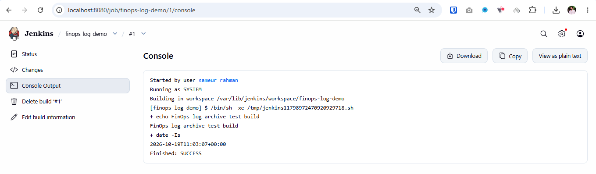
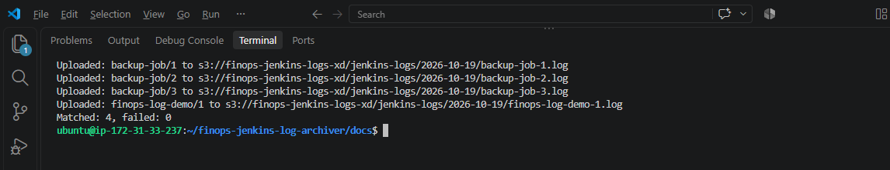
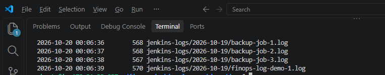
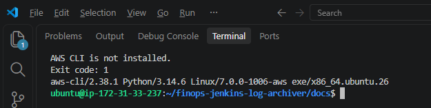
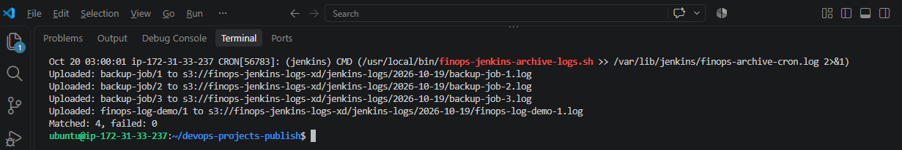

# FinOps Jenkins Log Archiver

A portfolio project that archives Jenkins build logs from AWS EC2 to a private Amazon S3 bucket. In the project scenario, logs were previously stored in an ELK stack; S3 is being evaluated as a potentially lower-cost archive. **Cost savings have not been measured.**

The archive runs as the `jenkins` user with an EC2 IAM role. Manual success and failure tests passed. The scheduled 03:00 Asia/Dhaka cron run was verified on 2026-10-20 at 03:00:01 BDT, with four logs uploaded and zero reported failures.

## Application

- Scans direct Jenkins jobs at `/var/lib/jenkins/jobs/<job>/builds/<number>/log`.
- Selects logs last modified on the previous calendar day in Asia/Dhaka (BDT).
- Uploads them to `s3://finops-jenkins-logs-xd/jenkins-logs/<date>/<job>-<build>.log`.
- Leaves the original Jenkins logs on EC2; the script does not delete them.
- Reports matching logs and failed uploads; returns a non-zero status if an upload fails.
- Demo scope: no Jenkins folder/multibranch traversal, build-completion check, log redaction, or duplicate-upload avoidance yet.

## Stack

Bash, Jenkins, AWS CLI v2, cron, Ubuntu on AWS EC2, IAM instance role, and Amazon S3 in `ap-southeast-1` (Singapore). The EC2 system timezone is `Asia/Dhaka`; the AWS region does not determine the system timezone.

## Architecture

```text
Jenkins build logs on EC2
        |
        v
scripts/archive-logs.sh (deployed to /usr/local/bin)
        |  runs as jenkins via cron, 03:00 Asia/Dhaka
        |  uses AWS CLI + EC2 IAM role; no static access keys on EC2
        v
Private S3 bucket: finops-jenkins-logs-xd
        `-- jenkins-logs/YYYY-MM-DD/job-name-build-number.log
```

The Jenkins web UI was accessed through an SSH tunnel (`http://localhost:8080/` on the local computer); inbound port 8080 was not opened publicly.

## Run on EC2

Prerequisites: Jenkins installed at `/var/lib/jenkins`, AWS CLI v2 available to the `jenkins` user, a private S3 bucket in `ap-southeast-1`, and an EC2 IAM role permitted to list the `jenkins-logs/` prefix and upload objects under it. No static AWS access keys are required on EC2.

From the **project directory**, check syntax and deploy the version-controlled source file:

```bash
bash -n scripts/archive-logs.sh
sudo install -o root -g root -m 0755 scripts/archive-logs.sh \
  /usr/local/bin/finops-jenkins-archive-logs.sh
```

Run manually as the `jenkins` user. Without an override, the script checks the **previous BDT day**:

```bash
sudo -u jenkins /usr/local/bin/finops-jenkins-archive-logs.sh
```

For the recorded test build, the date was overridden to match its log modification date:

```bash
sudo -u jenkins env DATE=2026-10-19 \
  /usr/local/bin/finops-jenkins-archive-logs.sh
```

A rerun for the same date/job/build uploads to the same key again and may overwrite the existing object. The script does not delete local logs.

## S3 Object Layout

| S3 key | Meaning |
|---|---|
| `jenkins-logs/2026-10-19/finops-log-demo-1.log` | Test job `finops-log-demo`, build #1, selected for 2026-10-19 BDT |
| `jenkins-logs/2026-10-19/backup-job-2.log` | Test job `backup-job`, build #2 |

S3 uses object-key prefixes here; `jenkins-logs/` is not a separate filesystem directory. The IAM policy grants `s3:PutObject` on `jenkins-logs/*` and prefix-restricted `s3:ListBucket`. It does not grant object deletion.

## Configuration

The current `0.1.0` script keeps infrastructure settings in the source file; they are not all environment overrides. The bucket name is not a secret, but moving it into configuration would improve portability. Before deploying in another AWS account, update these values and grant the EC2 role access to the corresponding bucket prefix.

| Setting | Current value | Purpose |
|---|---|---|
| `JENKINS_HOME` | `/var/lib/jenkins` | Jenkins data directory; set in the script |
| `S3_BUCKET` | `s3://finops-jenkins-logs-xd` | Destination bucket URI; set in the script |
| `AWS_REGION` | `ap-southeast-1` | Bucket region; set in the script |
| `DATE` | Previous BDT date by default | Target log modification date; may be overridden for testing |
| Cron `PATH` | `/usr/local/bin:/usr/bin:/bin` | Makes AWS CLI available to cron |

Do not add AWS access keys to this repository or to the script. Review Jenkins logs for secrets before archiving them: the script does **not** redact log content.

## Schedule with cron

The `jenkins` user's crontab contains these two active lines:

```cron
PATH=/usr/local/bin:/usr/bin:/bin
0 3 * * * /usr/local/bin/finops-jenkins-archive-logs.sh >> /var/lib/jenkins/finops-archive-cron.log 2>&1
```

Check the saved entry and service:

```bash
sudo crontab -u jenkins -l
systemctl is-active cron
timedatectl show -p Timezone --value
```

Expected service status is `active` and timezone is `Asia/Dhaka`. At 03:00 BDT the default target is **the preceding BDT calendar day**. If EC2 is stopped then, ordinary cron does not replay the missed run.

To inspect a scheduled run, check its output:

```bash
sudo -u jenkins tail -n 30 /var/lib/jenkins/finops-archive-cron.log
```

For the recorded 2026-10-20 run, the journal confirmed that cron invoked the script at **03:00:01 BDT**:

```bash
sudo journalctl --since "2026-10-20 02:55:00" \
  --until "2026-10-20 03:10:00" --no-pager |
  grep -F 'finops-jenkins-archive-logs.sh'
```

The cron log may not exist before the first run on a new deployment. Plan log rotation if this lab is kept running.

## Verification and Tests

From EC2, check the instance-role identity without configuring an access key:

```bash
sudo -u jenkins aws sts get-caller-identity --region ap-southeast-1
```

For the recorded run, S3 listed all four archived objects:

```bash
sudo -u jenkins aws s3 ls \
  s3://finops-jenkins-logs-xd/jenkins-logs/2026-10-19/ \
  --recursive --region ap-southeast-1
```

The listing confirms the presence and sizes of objects; it does not verify their contents. The scheduled run was verified separately with the journal and cron output. A Jenkins test build showed `Finished: SUCCESS`. The script printed `Matched: 4, failed: 0`, including three intentionally safe `backup-job` logs and one `finops-log-demo` log.

## Simulate Failure and Recovery

This test temporarily removes AWS CLI from **one process's** `PATH`. It does not uninstall AWS CLI or change cron:

```bash
sudo -u jenkins env PATH=/no-aws-here DATE=2026-10-19 \
  /bin/bash /usr/local/bin/finops-jenkins-archive-logs.sh
echo "Exit code: $?"
sudo -u jenkins aws --version
```

Observed: `AWS CLI is not installed.`, exit code `1`, then normal AWS CLI availability. This tests the missing-CLI branch, **not** an S3 permission or network outage. No object upload was attempted during the simulated failure.

## Repository Contents

| Path | Contents |
|---|---|
| `scripts/archive-logs.sh` | Bash archiver source, version `0.1.0` |
| `docs/test-results.md` | Manual success, failure/recovery, and verified 03:00 BDT cron execution |
| `README.md` | Setup, operation, evidence, limitations, and cleanup |
| `docs/screenshots/` | Five evidence screenshots: build, upload, S3 listing, failure/recovery, and cron |

The installed `/usr/local/bin/finops-jenkins-archive-logs.sh` is a deployment copy, not the repository source. Reinstall it after changing the source file.

## Verification Evidence

See [recorded test results](docs/test-results.md).

Verified on EC2:

- Jenkins `finops-log-demo` build #1 succeeded.
- An S3 smoke test and a manual Jenkins log upload succeeded with the instance role.
- The deployed script, run as `jenkins`, matched and uploaded four logs with zero reported failures.
- S3 listing showed `backup-job-1.log`, `backup-job-2.log`, `backup-job-3.log`, and `finops-log-demo-1.log` under the test date.
- The simulated missing-CLI case exited with status `1`; AWS CLI worked afterward.
- On **2026-10-20 at 03:00:01 BDT**, the journal recorded a `(jenkins) CMD` for the scheduled script; its cron output reported `Matched: 4, failed: 0`.

**Pending:** a measured ELK-versus-S3 cost comparison. No cost savings are claimed yet.

## Limitations and FinOps Notes

- Only directly nested Jenkins job directories are scanned; folder/multibranch jobs are not covered.
- File modification date is used. The script does not confirm that a build has finished before uploading, nor does it prevent repeated uploads to the same S3 key.
- A day missed while EC2 is off is not backfilled automatically.
- No log secret scanning, lifecycle expiration, retrieval/integrity check, or measured retention policy is implemented yet.
- S3 storage and requests, EC2 runtime, EBS, and public IPv4 may incur charges. S3 is not automatically cheaper overall: compare actual volumes, retention, request counts, and ELK/EC2 costs before claiming savings.

## Cleanup

To stop future archive runs, remove **only this project's** entry from the `jenkins` user's crontab with `sudo crontab -u jenkins -e`; do not stop system cron if other jobs use it. Preserve the repository and any required log evidence before stopping or terminating EC2. Stopping EC2 also stops Jenkins and prevents cron from running.

Review retention and compliance requirements before deleting S3 objects or the bucket. Remove unused IAM roles, policies, EBS volumes, and public IP allocations only when the lab is fully retired. Never commit `.pem` private keys, access keys, or raw production logs.

## Screenshots

### Jenkins Build Success


### Script Upload Success


### S3 Archived Objects


### Failure and Recovery


### Scheduled Cron Execution


